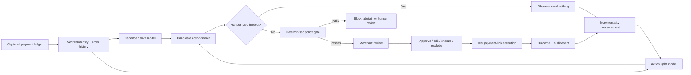

# ReCycle — Incremental Repeat-Revenue Agent

ReCycle is an AI-native decision experience for replenishable D2C brands. It identifies customers who have drifted past their own purchase rhythm, estimates which intervention is most likely to create an **incremental** reorder, checks that action against deterministic merchant policies, and asks for approval before execution.

> This repository is a product prototype built for Razorpay's **Recover and Grow with AI** track. All merchants, customers, probabilities, uplift values and financial outcomes are synthetic. The checkout is test-only and no money or customer message is sent.

**Live prototype:** https://recycle-ai-pm.vercel.app/

## Why this exists

Flat 30-day retention campaigns mistime customers with different consumption rhythms and often discount buyers who would have returned naturally. ReCycle makes a narrower decision:

> Who is likely to purchase because the merchant acts, which action creates the most contribution margin, and when is doing nothing better?

The initial wedge is single-category, replenishable D2C merchants—coffee, pet food, supplements and personal care—where captured-payment history is a useful proxy for consumption cadence.

## Why this is worth building

The merchant loses in two directions today: fixed-date reminders mistime different consumption rhythms, while blanket coupons surrender margin to customers who would have reordered anyway. ReCycle targets repeat contribution margin rather than campaign activity.

For Razorpay, the merchant outcome and platform outcome point in the same direction: an incremental reorder is additional merchant margin and an additional payment flowing through Razorpay. The concept also fits Agent Studio's published review-first, policy-validated and auditable direction while covering an adjacent gap: non-subscription customers who quietly drift after a successful purchase.

See the [full business case](docs/BUSINESS_CASE.md), including merchant economics, platform upside, differentiation and the honest counter-case.

## Challenge rubric in one screen

| Question | ReCycle's answer |
|---|---|
| What signal identifies the opportunity? | Captured-payment recency, frequency, interpurchase intervals, amount/SKU when available, verified identity and prior intervention outcomes. |
| Why is AI necessary? | The system estimates individual cadence, active probability and heterogeneous action uplift; a fixed 30-day rule cannot distinguish natural slow buyers from persuadable drift. |
| What action does it produce? | `DO_NOTHING`, reminder, one-tap reorder link or a bounded incentive—ranked by expected incremental contribution margin. |
| What can the merchant control? | Review the explanation, change the action/copy, approve, snooze, exclude, edit policy thresholds or use the kill switch. |
| How does it learn? | A pre-assigned holdout measures incremental margin; intervention-tagged outcomes update uplift without contaminating organic cadence. |
| How are trust and failure handled? | Deterministic identity, consent, confidence, frequency, discount and margin gates; abstention, audit logs and eight regression scenarios. |
| What outcome matters? | Holdout-measured incremental contribution margin per eligible customer, with opt-out/block rate as a health guardrail. |

## What the prototype demonstrates

- An opportunity queue ranked by expected incremental contribution margin.
- Customer-specific cadence explanations and four candidate actions.
- **Do nothing** as a first-class decision, not a failure state.
- Merchant controls to edit, approve, snooze, exclude or stop.
- Personalized WhatsApp copy and a Razorpay-style test payment-link preview.
- A pre-assigned 10% holdout that receives no intervention.
- A Learning Lab that separates expected value from measured lift.
- Deterministic consent, identity, frequency, margin and discount gates.
- An audit trail, kill switch and executable eight-scenario policy harness.

## Decision flow



The LLM is never trusted with rupee arithmetic, eligibility or permissions. It is used for explanation and message drafting; deterministic code owns the policy gate and economics.

## The math, briefly

For customer features `x`, action `a` and a seven-day purchase outcome `Y`:

```text
uplift_a(x) = E[Y | do(a), x] - E[Y | do(no_action), x]

expected_incremental_margin_a =
  uplift_a(x) × base_contribution_margin
  - message_or_channel_cost_a
  - P(purchase | a, x) × discount_cost_a

decision(x) = argmax_a expected_incremental_margin_a
              subject to merchant policy and consent
```

`no_action` is included with zero action cost. If every intervention has negative or unsafe value, ReCycle abstains or recommends doing nothing.

The production design uses a Buy-Till-You-Die model (BG/NBD or Pareto/NBD) for active-customer probability and expected transactions. Merchants see the simpler explanation layer: mean purchase interval `μ`, variability `σ`, days since last purchase `d`, and a lateness score `(d - μ) / max(σ, ε)`. The prototype displays synthetic outputs; it does not claim to train a production model in the browser.

See [Model, measurement and safety](docs/MODEL_AND_SAFETY.md) for the complete decision specification.

## Holdout and learning loop

Eligible customers are randomly assigned to treatment or the protected holdout **before scoring**. The primary production metric is the intention-to-treat difference in net contribution margin:

```text
incremental_margin_per_eligible_customer =
  mean(net_margin | assigned_treatment)
  - mean(net_margin | assigned_holdout)
```

Guardrails include opt-out/block rate, complaint rate, refund rate and contribution-margin floor. Purchases following an intervention are tagged separately so induced orders do not contaminate the natural-cadence estimate.

## Guardrail summary

| Gate | Prototype default | Failure behavior |
|---|---:|---|
| Verified identity | Required | Human review / abstain |
| Captured-order history | 3 minimum; 4 for variance-aware cadence | Fall back or abstain |
| Valid message consent | Required | Block outreach |
| Opt-out / exclusion | Hard stop | Block all future outreach |
| Model confidence | 70% minimum | Abstain |
| Contact frequency | 2 per month | Block until reset |
| Maximum discount | 5% | Reject candidate action |
| Contribution margin | ₹150 minimum | Reject candidate action |
| Experiment holdout | 10% | No intervention |
| Global kill switch | Merchant-controlled | Stop pending actions |

Run the executable policy harness:

```bash
npm run harness
```

## Local development

Requirements: Node.js 22.13 or newer.

```bash
npm install
npm run dev
```

Then open http://localhost:3000.

Validation commands:

```bash
npm run harness
npm run build
npm run build:vercel
```

## Vercel deployment

The repository includes `vercel.json` and a standard Next.js production build:

1. Import the repository into Vercel.
2. Keep the detected framework as **Next.js**.
3. No environment variables are required for this synthetic prototype.
4. Deploy.

## Repository map

```text
app/page.tsx                 Interactive product experience and synthetic cases
app/globals.css              Razorpay-inspired visual system and responsive layout
scripts/decision-harness.mjs Executable deterministic policy scenarios
docs/MODEL_AND_SAFETY.md     Model, economics, holdout and failure-mode specification
docs/BUSINESS_CASE.md         Merchant economics, Razorpay value and counter-case
docs/AI_BUILD_LOG.md         How AI accelerated research, decisions and implementation
docs/DEMO_SCRIPT.md          90-second submission walkthrough
vercel.json                  Vercel build configuration
```

## Deliberately out of scope

- Live WhatsApp delivery or production Payment Links.
- Automatic discount issuance without merchant approval.
- Multi-SKU basket-level consumption inference.
- Claims of production uplift, model accuracy or universal data coverage.
- Replacing a CRM, campaign manager or subscription platform.

The prototype is designed to test the product decision and control model before expanding the integration surface.
